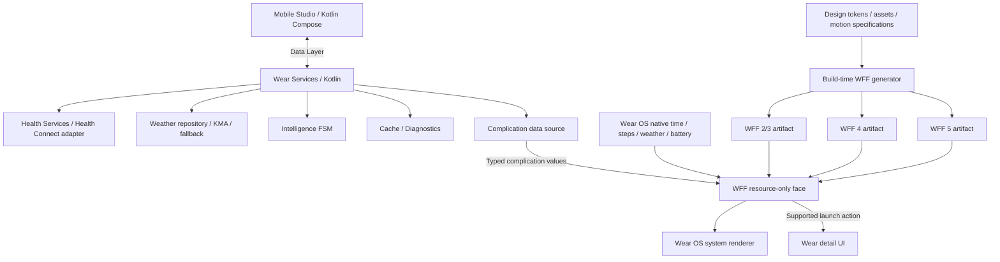

# 전체 설계도 — v1.0

상태: 설계 기준선. 실기기·빌드 미검증. 요구사항 ID는 [REQUIREMENTS.md](REQUIREMENTS.md)를 참조한다.

## 1. 제품 구조


- Watch Face: 시간, 정보 배치, 소재, 모션, AOD, 테마 및 지원되는 터치 동작. 시스템 렌더러에서 실행한다.
- Wear Services: 데이터 수집, 캐시, 권한, 상황 판단, 컴플리케이션 제공, 상세 화면.
- Mobile Studio: 설정, 프리셋, 건강 동기화, 기기 정보, 미리보기, 설치/업데이트 지원. 1차 기본 페이스의 실행 필수 조건이 아니다.
- Build tooling: 디자인 토큰, 자산 변환, 버전별 XML 생성, 검증 및 회귀 시험. 워치 런타임 코드가 아니다.

WFF에는 android:hasCode=false를 적용한다. WFF와 실행 코드 앱은 분리한다. Wear/phone Data Layer 앱의 패키지명 및 서명 일치 조건을 확인한다. WFF 패키지는 별도로 관리한다. 배포 시 application ID, versionCode 및 variant 선택 정책을 ADR로 확정한다.

## 2. 모듈 책임
| 모듈 | 위치 | 계약 |
|---|---|---|
| Continuity / Motion | WFF + 생성 도구 | 상태별 좌표, 변환, 보간, 지원 트리거 |
| Material / Optical / Spatial | 자산 + WFF | 공통 광원, 마스크, 깊이별 레이어 |
| Typography / Theme / Interaction | WFF | 글꼴, 레이아웃, 설정, launch |
| Intelligence | Wear domain | ContextSnapshot → PresentationIntent |
| Health / Weather / Sensors | adapters | 데이터 수집 및 표준화 |
| Complications | Wear adapter | Snapshot → 지원 데이터 타입 |
| Configuration | Wear/mobile | 버전형 설정, 검증, 이전 |
| Cache | Wear/mobile | TTL, 출처, 시각, 오류 |
| Efficiency | 정책 + WFF | 기능별 전력 프로필 |
| Diagnostics | Wear/mobile + tooling | 비식별 로그 및 상태 |
| Detail UI | Wear Compose | 상세 정보 및 앱 내부 모션 |
| Mobile Studio | Android Compose | 프리뷰, 사용자 설정, 동기화 |

domain은 Android 프레임워크와 네트워크 구현에 의존하지 않는다. adapter는 domain 인터페이스를 구현한다. UI와 complication은 repository에 직접 네트워크 요청하지 않는다. 의존성 주입은 composition root에서 한다.

## 3. 프로젝트 구조 (예정)
```
apps/{watchface,wear-services,mobile-studio}
modules/{domain,health,weather,sensors,intelligence,complications,configuration,cache,efficiency,diagnostics}
design-system/{tokens,typography,materials,continuity,motion,layouts,themes}
assets/{source,textures,vector,animations,generated}
compatibility/{wff2,wff3,wff4,wff5,device-profiles}
tools/{asset-compiler,wff-generator,wff-validator,memory-evaluator,visual-regression}
tests/{unit,integration,visual,compatibility,performance,device}
docs/{adr,evidence,work-orders}
.github/workflows
```
경로는 설계안이다. 빈 모듈을 모두 생성하지 않는다. 해당 WO에서 필요한 모듈만 추가한다.

## 4. 데이터 경계
Wear 앱의 상태는 전체 WFF 장면 제어 명령이 아니다. 지원 타입의 수치, 텍스트, 이미지, 색상으로 투영한다. WFF 4 Reference의 교차 요소 참조는 PoC에서 검증한다. 하위 버전은 슬롯별 표시 또는 WFF 자체 상태로 대체한다. 갱신이 느리거나 연결이 끊겨도 시계는 계속 동작한다.

상세 화면은 Compose에서 더 정교한 애니메이션 및 AGSL을 검토한다. 시스템 경계를 넘는 완전한 공유 요소 전환은 보장하지 않는다. 동일 색상·위치·아이콘으로 시각적 연결을 모사한다.

## 5. 주요 설계 결정
| ADR 후보 | 결정 | 상태 |
|---|---|---|
| ADR-001 | WFF 리소스 전용 + Wear 앱 분리 | 기준선 |
| ADR-002 | 공통 소스에서 WFF 2~5 생성 | PoC 필요 |
| ADR-003 | Signature 우선, 8개 테마 | 기준선 |
| ADR-004 | 규칙 기반 FSM 우선 | 기준선 |
| ADR-005 | 기상청 우선, Open-Meteo 대체 | 권한·약관 확인 필요 |
| ADR-006 | WFF 4 Reference로 제한된 그래픽 공유 | PoC 필요 |
| ADR-007 | Watch Face Push 및 패키지 정책 | 미확정 |

제품 요구사항과 기술 한계가 충돌하면 대체 시각 효과를 먼저 검토한다. 불가능한 구현을 정상 기능으로 주장하지 않는다.
